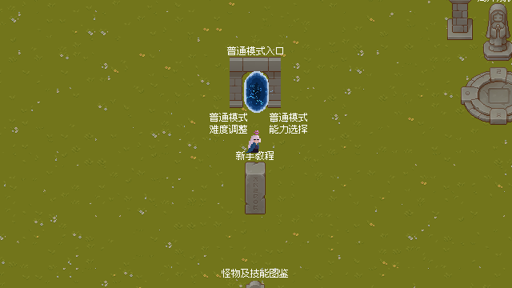
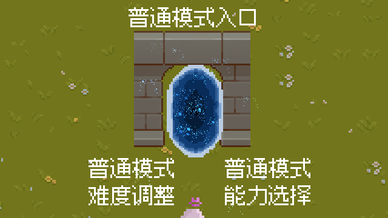
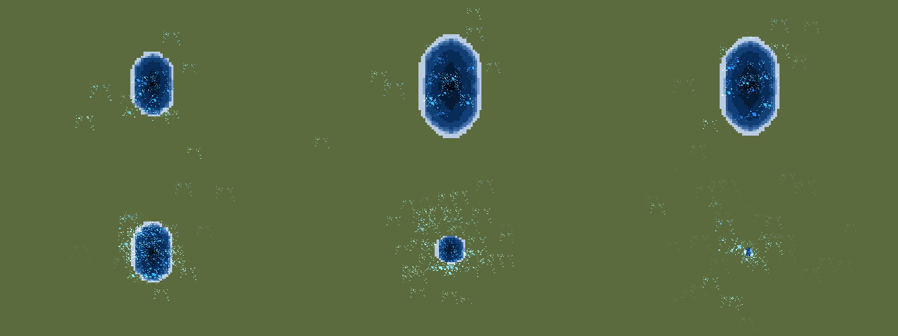
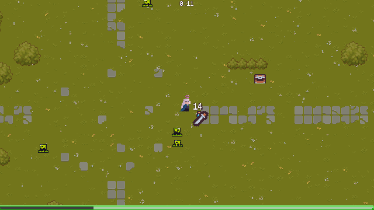

<div align="center">

# 神秘幸存者 · The Mystic Survivor

**一款用 Godot 4.7 手搓的 2D 肉鸽生存小游戏**

在神秘的地图上不断击退涌来的怪物，靠升级卡片一点点构筑自己的流派，
撑过十分钟，成为最后的幸存者。

[游戏简介](#游戏简介) · [玩法特色](#玩法特色) · [游戏截图](#游戏截图) · [快速开始](#快速开始) · [文档目录](docs/README.md) · [开发进度](#开发进度)

</div>

---

## 游戏简介

《神秘幸存者》（The Mystic Survivor）最早发布在 **TapTap** 上，是一个体量不大、但系统比较完整的
Roguelite 生存游戏：走位、自动攻击、升级三选一、难度递进、成就与图鉴，该有的都有。

整个项目没有用任何商业框架，场景、脚本、存档、音效逻辑全部手搓；
敌人不是一堆各自写死的脚本，而是**用二十多个"组件"拼出来的**，
所以加一个新怪物常常只需要在编辑器里拖几个组件、再填一个数据资源。

> 项目名 `The-Mystic-Survior` 是仓库建立时留下的拼写，游戏正式名字是「神秘幸存者」。

## 玩法特色

- **自动战斗 + 纯走位**：所有攻击都会自动触发，玩家只负责跑位与选能力。
- **能力构筑**：剑、火球、圣光、天堂之怒、光环、枪械（AK / 霰弹 / 狙击 / RPG）……
  抽到什么样的卡，就走什么样的流派。
- **十五种敌人**：史莱姆、狼、猫头鹰、石魔、巫婆、骷髅、骑士、亡灵……每种都有自己的行为组件组合。
- **特殊事件**：包围圈、箭头阵、蘑菇雨、"看不见的敌人"等刷怪玩法会随难度解锁。
- **难度与挑战**：简单 / 普通 / 困难 / 挑战，以及"时间加长""禁用能力""能力最多三次"等挑战选项。
- **成就系统**：通关、无伤、放生流……成就存档写在 `user://achievements.save`。
- **手机可玩**：内置虚拟摇杆，桌面端也可以用鼠标模拟触摸。

## 游戏截图

| 主地图大厅（新） | 传送门 |
| --- | --- |
|  |  |

| 传送门动画（开 → 待机 → 进入） | 战斗 |
| --- | --- |
|  |  |

## 操作方式

| 操作 | 键盘 | 手机 |
| --- | --- | --- |
| 移动 | `W A S D` / 方向键 | 虚拟摇杆 |
| 确认（选卡、互动） | `空格` | 点击 |
| 暂停 / 打开设置 | `Esc` | 右上角按钮 |

> 暂停 / 局内设置的入口目前还在接（旧的暂停菜单没接上），详见 [开发路线](docs/08-开发路线与待办.md) 的「已知问题」。

## 快速开始

### 环境

- [Godot Engine 4.7](https://godotengine.org/download)（标准版即可，**不需要** .NET 版本）
- 渲染后端：Forward+（项目默认）

### 运行

1. 用 Godot 4.7 打开仓库根目录的 `project.godot`；
2. 按 `F5`（或点右上角 ▶）。游戏启动场景是 `scene/大场景/main_map.scn`；
3. 走到地图上的**传送门**里，就会进入战斗场景 `scene/大场景/game.scn`。

想单独调试某个场景，可以在 Godot 里直接打开对应的 `.tscn`，按 `F6` 运行。

### 导出

仓库里已经有三套导出预设（`export_presets.cfg`）：

| 平台 | 预设名 | 说明 |
| --- | --- | --- |
| Windows | `Windows Desktop` | 桌面端主要发行平台 |
| macOS | `macOS` | 需要签名配置 |
| Android | `Android` | 手机端，构建目录在 `android/build` |

## 项目结构

```text
The-Mystic-Survior/
├── project.godot            # 工程配置（主场景、输入映射、物理层、主题、自动加载）
├── scene/                   # 场景（.tscn / .scn）
│   ├── 大场景/              # ★ 主地图 main_map、战斗场景 game、信号总线 game_event
│   ├── 场景互动件/          # 地图上的可互动物件（传送门、确认物体……）
│   ├── player.tscn          # 玩家
│   ├── enemy/               # 各种敌人
│   ├── enemy_component/     # 敌人组件（血量、受伤、速度、掉落……）
│   ├── ability/             # 玩家能力（剑、火球、枪械……）
│   ├── manager/             # 局内管理器（刷怪、经验、升级、计时、音乐）
│   ├── ui/                  # 所有界面（设置、图鉴、升级选卡、结算……）
│   └── 模板/ 废案/ 测试用场景/
├── script/                  # 脚本（.gd），目录结构与 scene/ 基本一一对应
├── resource/                # 数据资源（能力升级 .tres、敌人解锁表、主题、成就）
├── sucai/                   # 美术 / 音频素材（按来源分类）
├── docs/                    # ★ 文档目录，见 docs/README.md
└── addons/                  # 第三方编辑器插件
```

每个目录的职责、关键脚本清单都在 [docs/02-项目结构.md](docs/02-项目结构.md)。

## 文档目录

完整文档在 **[docs/README.md](docs/README.md)**，下面是导航：

| 文档 | 内容 |
| --- | --- |
| [01 · 快速开始](docs/01-快速开始.md) | 环境、运行、调试、导出 |
| [02 · 项目结构](docs/02-项目结构.md) | 目录树、场景与脚本对照表 |
| [03 · 架构总览](docs/03-架构总览.md) | 自动加载、信号总线、组件化敌人、能力系统、管理器 |
| [04 · 代码风格](docs/04-代码风格.md) | 命名、缩进、注释、类型标注等写法约定 |
| [05 · 大厅与传送门](docs/05-大厅与传送门.md) | 取消主界面的改造、传送门动画的实现与调参 |
| [06 · 场景与UI流程](docs/06-场景与UI流程.md) | 从大厅到战斗、死亡/胜利、结算返回的完整流程 |
| [07 · 素材与资源](docs/07-素材与资源.md) | 素材来源、主题字体、音频总线、导入设置 |
| [08 · 开发路线](docs/08-开发路线与待办.md) | 已完成、进行中、计划中的功能 |
| [09 · 技术要点](docs/09-技术要点.md) | 项目真正的技术亮点、量化数据、简历话术 |
| [10 · 性能优化记录](docs/10-性能优化记录.md) | 微基准、优化前后数据、没做什么以及为什么 |
| [11 · 简历技术要点](docs/11-简历技术要点.md) | 可直接抄进简历的版本 |
| [12 · 模板与工具函数](docs/12-模板与工具函数.md) | 加新内容前必看：模板清单与可复用函数 |
| [13 · 图鉴](docs/13-图鉴.md) | 游戏内技能 / 敌人图鉴：入口、布局、数据来源、怎么加演示视频 |
| [游戏资料库（网页）](docs/enemies.html) | 敌人、刷新事件、玩家能力、难度设定一览，附 DIY 新建敌人（可传立绘） |

## 开发进度

- ✅ 战斗核心：玩家、能力、敌人组件、刷怪、升级、结算、成就
- ✅ 难度 / 挑战模式、图鉴、设置、感谢名单（界面都做好了，入口还挂在旧主界面上，待搬进大厅）
- 🚧 **取消主界面**：游戏启动直接进入 `main_map`，原来的"开始游戏 / 设置 / 图鉴……"
  改为在地图上和物品互动来完成
  - ✅ **进入游戏**：走进传送门 → 传送门收缩爆开 → 淡入 `game.scn` 开始游玩
  - ⬜ 难度调整、能力选择、新手教程、局外成长、无尽模式、图鉴、感谢名单、退出游戏
- ✅ 测量驱动的性能优化：飘字对象池（单次创建 48.4µs → 13.1µs，-73%）、去掉每只敌人一个 Timer
- ⬜ 音效 / 手感打磨、移动端适配细节

更细的拆解见 [docs/08-开发路线与待办.md](docs/08-开发路线与待办.md)。

## 参与贡献

欢迎提 Issue 或 PR！动手之前建议先看：

1. [docs/04-代码风格.md](docs/04-代码风格.md) —— 项目里的写法习惯（缩进用 Tab、注释写中文、能用 `! x` 就不用 `not`……）；
2. [docs/03-架构总览.md](docs/03-架构总览.md) —— 弄清 `GameEvent` 信号总线和敌人组件的套路再改，能少走很多弯路。

## 致谢

游戏里的美术与音频素材全部来自免费资源作者，感谢他们：

**Brackeys' Platformer Bundle**（Brackeys / analogStudios_ / RottingPixels）、
**Kam's Free Music Pack 1-2**（KameronGuajardoVGM）、
**Pixel Art Top Down - Basic**（Cainos）、
**FREE Pixel Combat SFX**（Helton Yan）、
**Swords & Blades Sound Pack**（Leonardo Calvo）、
**Simple Music & SFX**（foggysunrise）、
**Forest Monsters 2D Pixel Art**（MonoPixelArt）、
**Superior Sound FX: Lasers and Explosions**（SoireeGames）、
**Snake's Authentic Gun Sounds**（SnakeF8）、
**High-Quality Gun Sound Effects Pack**（Capbuu Games）、
**Boss: Mecha-Stone Golem**（Kronovi-）、
以及 **Kenney**。

还有所有在 itch.io 上无偿分享素材的创作者 —— 没有你们，这个游戏做不出来 🙏

## 开源许可

仓库目前**还没有添加 LICENSE 文件**，代码主要用于学习交流，素材版权归原作者所有。
如果你想把这个项目用在正式作品里，请先联系作者，并自行确认所使用素材的授权协议。