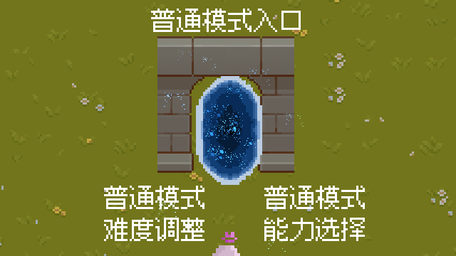
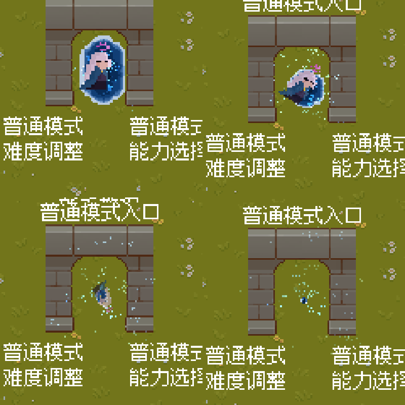
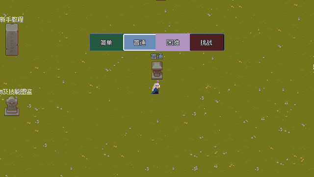
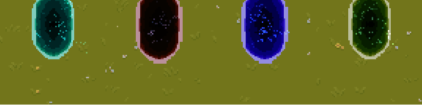
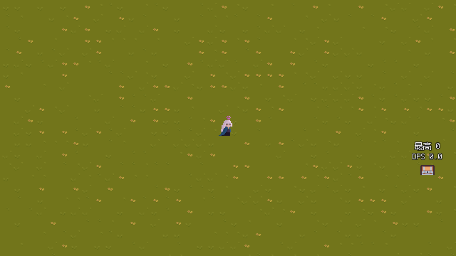

# 05 · 大厅与传送门

> 这一页讲这次改造的两个东西：**取消主界面**（新的大厅 `main_map`）和
> **传送门进入游戏**（`portal.tscn` 的动画 + 进入流程）。

---

## 一、为什么要取消主界面

原来的流程是"主界面（按钮菜单）→ 点开始游戏 → 进入 game.scn"。
现在改成：**一进游戏就站在一张大地图上，想要什么功能，就走到地图上的那个东西面前**。

```text
改造前：  maintheme.tscn（主界面） ──按钮──▶ game.scn
改造后：  main_map.scn（大厅地图） ──走进传送门──▶ game.scn
```

好处是"菜单"变成"场景"的一部分：

- 主界面的功能（开始 / 难度 / 图鉴 / 感谢 / 设置 / 退出）都能做成一栋建筑、一个 NPC、一个法阵；
- 大厅本身就是游戏世界的一部分，可以做局外成长、无尽模式入口；
- 以后想加"活动入口""商店"，在地图上摆个东西就行，不用再改 UI 布局。

### 现在做到哪一步了

| 功能 | 原来在主界面 | 现在 |
| --- | --- | --- |
| 开始游戏（普通模式） | 「开始游戏」按钮 | ✅ **走进传送门** |
| 难度调整 | 「难度选择」按钮 | ⬜ 地图上已有占位标签「普通模式 / 难度调整」 |
| 能力选择 | — | ⬜ 占位标签「普通模式 / 能力选择」 |
| 新手教程 | — | ⬜ 占位标签「新手教程」 |
| 局外成长 | — | ⬜ 占位标签「局外成长」 |
| 无尽模式 | — | ⬜ 占位标签「无尽模式入口」 |
| 怪物及技能图鉴 | 「图鉴」按钮 | ⬜ 占位标签「怪物及技能图鉴」 |
| 感谢名单 | 「感谢」按钮 | ⬜ 占位标签「感谢名单」 |
| 退出游戏 | 「离开」按钮 | ⬜ 占位标签「退出游戏」 |

> 这些占位标签都在 `main_map.scn` 的 `占位符` 节点下面，每个 `Label` 就是一处入口。
> 摆好物件后把对应 Label 删掉/换成 `确认物体` 即可。

---

## 二、大厅脚本 `main_map.gd`

```gdscript
extends Node2D

## 主地图（代替原来的主界面）。

@export var main_theme:AudioStream = preload("res://sucai/back_music/Brand New_0.wav")

var _music:AudioStreamPlayer

func _ready() -> void:
	GameEvent.end_run()      # 从一局游戏回来时，把暂停/难度/计时器清干净
	_play_main_theme()       # 放大厅音乐（原来主界面那首）
```

就这两件事，其余都在场景里摆着。

- **为什么要在 `_ready` 里 `end_run()`**：
  死亡/胜利结算时 `GameEvent.stop_game()` 会把 `get_tree().paused` 设成 `true`，
  如果切回大厅不把它关掉，大厅会"静止"（玩家能动是因为玩家节点设了 always 运行，但其他都不动）。
- **音乐为什么用代码建**：`main_map.scn` 是二进制场景，用脚本建 `AudioStreamPlayer`
  比在编辑器里加节点更安全，也方便以后换成别的 BGM。

---

## 三、传送门



> 大厅里那扇门就摆在石拱中间（`main_map.scn` 中 `Portal` 节点的坐标是 `(-295, -221)`）。

### 1. 场景结构

`scene/场景互动件/portal.tscn`（根节点脚本：`player_portal.gd`）

```text
Portal (Node2D)                        ← player_portal.gd 继承 Portal(portal.gd)
├── Glow (Sprite2D)                    ← 径向渐变 + 加色混合的柔和光晕（z_index -2）
├── AuraRing (Sprite2D)                ← 粒子图3：一圈光点，慢慢旋转（z_index -1）
├── PulseRing (Sprite2D)               ← 同一张图，每隔 2.6 秒往外扩一圈冲击波
├── AnimatedSprite2D                   ← 门主体：idle / open / close 三个动画
├── Effects (Node2D)
│   ├── Swirl (GPUParticles2D)         ← 粒子图2：绕着门旋进去的能量
│   ├── Sparks (GPUParticles2D)        ← 粒子图1：从门底往上飘的火星
│   └── Dust (GPUParticles2D)          ← 粒子图2：门周围慢慢飘的浮尘
├── Burst (GPUParticles2D)             ← 粒子图2：进入瞬间炸开（一次性）
├── Area2D                             ← 进入检测（掩码 = 玩家实体 第6层）
│   └── CollisionShape2D
└── NearArea2D                         ← 靠近检测（半径 92，用来"唤醒"门）
    └── CollisionShape2D
```

素材只有四样，全部在 `sucai/portal/`：

| 文件 | 用途 |
| --- | --- |
| `Portal.png`（64×64） | 主立绘：待机时的门 |
| `Portal-Sheet.png`（448×64，7 帧） | 门从"整扇"缩成"一个光点"的七帧，正放=关门，倒放=开门 |
| `Particle Effect 1.png`（32×32） | 单颗火星 |
| `Particle Effect 2.png`（32×32） | 一小片散落的星尘（尘埃、旋流、爆发都用它） |
| `Particle Effect 3.png`（32×32） | 一圈光点（当光环 / 冲击波用） |

> 光晕没有用新图片：它是一张 `GradientTexture2D`（径向渐变）在场景里现生成的，
> 所以 `sucai/portal/` 里不会多出莫名其妙的文件。

### 2. 三个阶段的动画

| 阶段 | 触发 | 表现 |
| --- | --- | --- |
| **开** | 进入场景 | `AnimatedSprite2D` 播 `open`（七帧倒放：光点 → 整扇门），播完切 `idle` |
| **待机** | 一直 | 门按正弦波"呼吸"（缩放 ±3%）；光晕跟着明暗变化；光环缓慢旋转；三组粒子持续发射；`PulseRing` 每 2.6 秒扩一圈 |
| **靠近** | 玩家进入 `NearArea2D` | 门放大 9%、光晕变亮 0.35、光环转得更快（`wake` 从 0 平滑补到 1） |
| **进入** | 玩家碰到 `Area2D` | 角色交出操控权、立绘边转边缩小被吸进门里；门播 `close` 收缩；`PulseRing` 隐藏；光环炸成 3.4 倍冲击波并淡出；光晕亮一下再灭；`Burst` 爆发一次；随后切场景 |

呼吸/旋转这类**循环动画**写在 `Portal._process()` 里（用 `sin()` 算，参数都在 `@export`）；
关门、爆发这类**一次性动画**用 `Tween`。

### 2.1 玩家是怎么被"吸"进去的

进入的瞬间，传送门会调用玩家自己的 `Player.be_sucked(传送门坐标)`（协程）：

1. **交出操控权**：`is_sucked = true`，`_physics_process` 直接 `return` 并把速度清零 ——
   这时候还按着方向键、或者摇杆还拖着，角色也不会再动；
2. **关掉局内东西**：`abilitymanager` 停跑（免得被吸的半秒钟还在放大招）、摇杆那一层 UI 隐藏；
3. **立绘做动画**：`AnimatedSprite2D` 用一个并行 Tween 同时做四件事 ——
   `rotation → TAU`（转一整圈）、`scale → 原大小的 5%`、平移向传送门中心、最后透明度降到 0.1；
   动画期间把 `z_index` 抬到 10，保证立绘画在传送门和粒子**上面**（否则会被门挡住看不见）；
4. 动画播完（`await`）才继续 `begin_run()` 和淡出切场景。

用 `EASE_IN` 是因为"被吸"应该是**越吸越快**：一开始慢慢转，最后一下猛地缩小消失。
动画时长是玩家脚本上的 `suck_time`（默认 0.55 秒），和门的 `enter_time`（0.5 秒）大致对齐。



> 四帧分别是 0.08s / 0.24s / 0.40s / 0.53s：角色一边转一边缩小，门同时收缩，最后只剩一撮粒子。

### 3. 可调参数

打开 `portal.tscn` 选中根节点，检查器里就是这些参数：

| 参数 | 默认 | 说明 |
| --- | --- | --- |
| `breath_scale` | 0.03 | 呼吸时缩放的最大偏移 |
| `breath_time` | 1.6 | 一次完整呼吸的秒数（越大越慢） |
| `breath_glow` | 0.08 | 呼吸时光晕明暗变化量 |
| `aura_speed` | 20.0 | 光环每秒转多少度 |
| `pulse_time` | 2.6 | 每隔几秒往外扩一圈冲击波 |
| `wake_scale` | 0.09 | 玩家靠近时门额外放大多少 |
| `wake_glow` | 0.35 | 靠近时光晕额外变亮多少 |
| `wake_time` | 0.35 | 从待机到"醒来"的过渡时间 |
| `enter_time` | 0.5 | 进入动画（收缩 + 爆发）的时长 |
| `enter_ring_scale` | 3.4 | 进入时冲击波放大到几倍 |
| `target_scene` | `game.scn` | 传送到哪个场景 |
| `fade_lead` | 0.5 | 吸人动画播到第几秒开始淡出（和动画重叠，不用干等动画播完） |

> 角色被吸进去的那段动画在玩家身上：`script/player.gd` 的 `suck_time`（默认 0.55 秒）。
> `fade_lead` 比 `suck_time` 小一点，就是为了让屏幕在动画最后变白、而不是先等它播完。

想让门"更大更亮"：把节点 `AnimatedSprite2D` 的 `scale` 调大，同时把 `Area2D` 的碰撞盒
和 `Glow`/`AuraRing` 的比例一起调 —— 这些都在场景里，不动代码。

### 4. 检测：谁能进来

```text
player.tscn (CharacterBody2D)  collision_layer = 第 6 层「玩家实体」
        ▲
        │ body_entered
Portal/Area2D                  collision_mask = 第 6 层
Portal/NearArea2D              collision_mask = 第 6 层（范围更大）
```

用 `body_entered` + `body is Player` 判断，比用"玩家的受伤区"更直接。
`Area2D` 自己占第 7 层「传送门」，以后如果有东西要检测传送门存在，就从这一层找。

### 5. 进入游戏的时序

```text
玩家碰到 Area2D
   │
   ▼
PlayerPortal.enter_game(who)
   ├─ play_enter()                    门收缩 + 冲击波 + 粒子爆发
   ├─ who.be_sucked(门的坐标)          立绘旋转缩小飞进门里（0.55s，**不 await**）
   ├─ await 0.5 秒                    (fade_lead：动画快播完时才开始淡出)
   ├─ GameEvent.begin_run()           重置难度 / 暂停 / 计时器，is_start = true
   └─ ScreenFade.change_scene(game.scn, 淡蓝色, 0.2, 0.25)
          │
          ▼
      淡出 0.2s（画面变白蓝）→ 切场景 → 淡入 0.25s
```

对应代码（`script/场景互动件/player_portal.gd`）：

```gdscript
func enter_game(who:Player)->void:
	if ! target_scene:
		push_warning("传送门没有设置 target_scene，无法进入游戏")
		return
	play_enter()
	#故意不 await：让"吸人"和"淡出"并行，动画快播完时屏幕已经在变白
	who.be_sucked(global_position)
	await get_tree().create_timer(fade_lead).timeout
	GameEvent.begin_run()
	ScreenFade.change_scene(target_scene,Color(0.78,0.9,1.0),0.2,0.25)
```

---

### 6. 实测时间线（本机）

```text
0ms       踩到传送门（物理检测约 50ms 后触发）
50ms      立绘开始被吸（0.55s）
550ms     淡出开始（0.2s）
750ms     屏幕全白 → 切场景：111ms（释放大厅）+ 128ms（新场景第一帧）都藏在这一帧
~880ms    淡入开始（0.25s）
~1130ms   完全可见、可以操作
```

两个"重活"（切场景 111ms、新场景首帧 128ms）都发生在**全白屏**时，玩家看不到卡顿；
真正在等的是动画 + 淡入淡出本身。`target_scene` 是 `portal.tscn` 的 ext_resource，
**加载大厅时就已经读进内存**（实测 `has_cached = true`），进传送门时没有磁盘 IO。

---

## 四、ScreenFade：为什么它要挂在根节点上

切场景时，Godot 会销毁 `current_scene` 整棵树 —— 如果你在旧场景里放一个黑色遮罩，
它会在切场景的瞬间一起消失，于是"淡出 → 变黑 → 亮起"就变成了"淡出 → 直接跳"。

`ScreenFade` 的做法是把自己挂到 **root**（`SceneTree.root`）上，而不是当前场景：

```gdscript
(Engine.get_main_loop() as SceneTree).root.add_child(fade)
```

这样它和当前场景是兄弟关系，切场景不会带走它；淡出到位后才调用
`change_scene_to_packed()`，等两帧新场景进树，再把遮罩淡掉并销毁自己。

用法就一行：

```gdscript
ScreenFade.change_scene(preload("res://scene/大场景/game.scn"))
ScreenFade.change_scene(target, Color.WHITE, 0.3, 0.5)   # 自定义颜色 / 淡出 / 淡入时长
```

> ⚠️ 注意：这个节点在 root 上，**不会**跟着 `get_tree().paused` 一起停
> （它设了 `PROCESS_MODE_ALWAYS`），所以即便从暂停界面切场景也能正常淡入淡出。

---

## 五、继续加其它入口

### 方案 A：复用"确认物体"（按下空格交互）

`scene/场景互动件/确认物体.tscn` 已经是一个现成的"靠近 + 按确认键"模板
（脚本 `script/场景互动件/确认物体.gd`，类名 `ConfirmStuff`）：

```gdscript
extends ConfirmStuff

## 举个例子：走到图鉴面前按空格
func input_event()->void:
	var screen = preload("res://scene/ui/skill_tujian.tscn").instantiate()
	add_child(screen)
```

把它摆到「怪物及技能图鉴」那个标签的位置，继承一下、重写 `input_event()` 就行了。

### 方案 B：做成另一个传送门

想让"无尽模式入口"也是一个传送门，直接复制 `portal.tscn`，
把根节点的 `target_scene` 换成目标场景，再改一下颜色（`modulate`）区分。

### 方案 C：写一个全新的互动脚本

遵守三个约定就不会跟现有代码打架：

1. 用 `Area2D` + `body_entered` 检测玩家（掩码 = 第 6 层「玩家实体」）；
2. 跨场景的状态变化走 `GameEvent`，不要直接改别人节点；
3. 切场景统一用 `ScreenFade.change_scene()`，别直接 `change_scene_to_file`（会突然跳画面）。

---

## 六、常见问题

**Q：走进传送门没反应。**
- 检查 `Area2D` 的 `collision_mask` 是不是勾了第 6 层（玩家实体）；
- 检查玩家场景的 `collision_layer` 是不是第 6 层；
- 检查 `Portal` 根节点的脚本是不是 `player_portal.gd`（不是 `portal.gd`，后者没有进入逻辑）。

**Q：门不播动画，只是个静止的图。**
- `AnimatedSprite2D` 的 `SpriteFrames` 里要有 `idle` / `open` / `close` 三个动画；
- 脚本里 `is_leaving` 为 true 时 `_process` 会直接返回，所以进入之后门就不动了（这是设计）。

**Q：改了 `main_map` 之后 Godot 报 "referenced non-existent resource / 循环依赖"。**
场景之间**不能互相引用**。这次就踩过一次：

```text
main_map → player.tscn → 死亡界面 → "返回大厅"按钮 → main_map   ✗ 循环
```

解决办法就是"返回大厅"按钮改成按**路径**切场景（`return_to_maintheme.gd` 里的 `screen_path`），
不再把 `main_map.scn` 作为 `@export var scene:PackedScene` 拖进去。

**Q：从战斗回到大厅，画面卡住不动。**
`GameEvent.paused` 没有归零。`main_map.gd` 的 `GameEvent.end_run()` 就是干这个的，别删。

---

## 七、难度切换物件

`scene/场景互动件/难度切换.tscn` —— 玩家靠近会在头顶弹出四块难度面板（简单 / 普通 / 困难 / 挑战），点一下就能换难度。

```text
DifficultySwitcher (Node2D)                 script = difficulty_switcher.gd
├── Sprite2D                                物件外观（草地城堡道具）
├── NameLabel (Label)                       物件上方：当前难度
├── ApproachArea (Area2D)                   mask = 第 6 层「玩家实体」，半径 39
│   └── CollisionShape2D
└── Panel (Panel)                           默认隐藏
    └── MarginContainer
        └── HBoxContainer
            ├── Seg3 (DifficultySegment, mode_index=0)  简单
            ├── Seg0 (DifficultySegment, mode_index=1)  普通
            ├── Seg1 (DifficultySegment, mode_index=2)  困难
            └── Seg2 (DifficultySegment, mode_index=3)  挑战
```

每块 `Seg` 挂 `difficulty_segment.gd`，用导出的 `mode_index` 记住自己是哪个难度；
父脚本**按 `mode_index` 认块**（递归找 `DifficultySegment` 类型），不看坐标、不看节点顺序、不看节点名——
所以换容器、挪位置、改名字都不影响判定。块里的 `Label` 文字默认由 `mode_index` 自动写，想自己放美术就关掉 `auto_label`。

| 行为 | 实现 |
| --- | --- |
| 靠近显示 / 离开隐藏 | `ApproachArea` 的 `body_entered` / `body_exited`（只认 `Player`） |
| 悬停高亮 | 每块 `mouse_entered` → 提亮 + 放大 1.06 |
| 点击选中 | 每块 `gui_input` 里判 `MOUSE_BUTTON_LEFT` → `GameEvent.select_mode(块的 mode_index)` |
| 上方标签 | 读 `GameEvent.mode_index`，同时监听 `GameEvent.mode_change` |



**全局状态**：沿用 `GameEvent.mode_index`（0 简单 / 1 普通 / 2 困难 / 3 挑战），默认值在 `GameEvent._ready()` 里设成 1。
挑战模式按"tag 全选"处理：`select_mode(3)` 会把 `hard_mode` 三个开关全开（时长加长 / 禁用能力 / 能力最多三次）。
简单模式目前只切 `mode_index`，不会自动打开它那三个"外挂" tag（其中 `is_initial` 的实现还有问题，见 [难度设定页](enemies.html#difficulty)）。
以后做 tag 选择界面时，改 `select_mode()` 一个函数即可。

> 场景已经由作者放进 `main_map.scn`。

---

## 八、传送门的区分方案（换色 / 改名字）

主世界会有很多入口，所以传送门用一个场景 + 每实例几个导出字段来区分，**加新门不用写代码**：

| 字段 | 作用 |
| --- | --- |
| `theme_color` | 这个门的色调。白色 = 原样；其它颜色会转色相并提亮，光晕、光环、粒子、门主体一起变 |
| `portal_name` | 门上方显示的名字（空 = 不显示） |
| `target_scene` / `target_path` | 去哪。两个场景互相传送时用 `target_path`（路径字符串），避免 PackedScene 循环引用 |
| `start_run` | 进门前要不要 `GameEvent.begin_run()`。训练场这种"不算一局"的场景设 `false` |

### 为什么用 shader 而不是直接乘颜色

门主体 `Portal.png` 是很深的藏蓝，直接乘颜色只会越来越黑（红、绿、金都变成接近黑色）。
所以加了一个只改色相的小 shader：[portal_hue.gdshader](../resource/shader/portal_hue.gdshader)，参数是 `hue_shift`（相对蓝色 0.58 的偏移）、`brightness`、`saturation`。
光晕 / 光环 / 粒子是加色混合的浅色贴图，直接用 `modulate` 换 RGB 就够了。



### 加一个新门

复制 `scene/场景互动件/训练场门.tscn` → 改三个值：

```text
theme_color  = 你说的颜色
portal_name  = "无尽模式"
target_scene = 目标场景（或用 target_path 填路径）
```

拖进 `main_map` 就完事。想更花一点可以再调实例上的 `pulse_time`（冲击波频率）、`aura_speed`（光环转速）、`enter_ring_scale`（进入爆发大小）。

---

## 九、训练场

`scene/大场景/训练场.tscn` —— 从主世界的绿门进去，专门用来试武器 / 打沙包。

```text
TrainingGround (Node2D)
├── grass (TileMapLayer)     和主地图同一套 tile，92×60 格草地
├── walls (StaticBody2D)     四堵隐形墙，围出 80×44 格的场地（±640 × ±352）
├── player                   出生在 (0, 80)
├── Sandbag1..3              三个测试沙包（头顶显示近 20 秒最高伤害 / DPS）
├── ReturnPortal             返回大厅的门（和训练场入口同色，绿色）
└── 前景 (Node2D)            在「前景图层」组里，飘字用
```

- 这里的沙包就是 `scene/测试用场景/新测试用box.tscn`：每挨一下播一次 hurt 动画，头顶显示 `最高` / `DPS`；
- 训练场**不算一局**：进门时 `start_run = false`，不会重置难度、不会启动刷怪；
- 返回大厅的门用 `target_path` 指向 `main_map.scn`，所以训练场和主世界之间不会互相 PackedScene 引用成环；
- 场的尺寸、沙包位置、返回门颜色都在 `scene/大场景/训练场.tscn` 里，改尺寸同时要改 `walls` 的四个矩形和 `grass` 的铺图范围。



