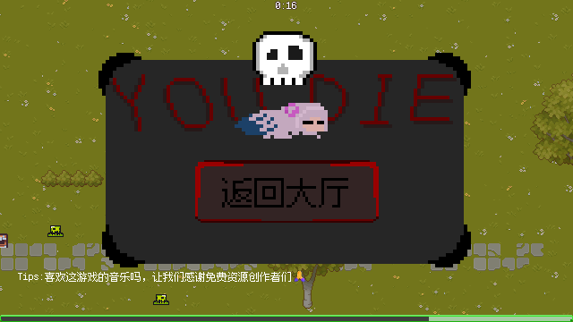

# 06 · 场景与UI流程

这一页把「玩家从打开游戏到打完一局」中间会经过哪些场景、状态怎么变，理成一张图。

---

## 一、总流程

```text
┌──────────────────────────────────────────────────────────────┐
│ 启动游戏                                                      │
│ main_map.scn（大厅）                                          │
│   • GameEvent.end_run()   ← 清掉上一局状态                    │
│   • 放大厅音乐                                                │
│   • 玩家自由走动，和地图上的东西互动                           │
└───────────────┬──────────────────────────────────────────────┘
                │ 走进传送门（player_portal.gd）
                ▼
┌──────────────────────────────────────────────────────────────┐
│ game.scn（战斗）                                              │
│   • GameEvent.begin_run()  ← 难度=1、计时器启动、is_start=true │
│   • EnemyManager 开始刷怪 → 37 秒一次难度 +1                  │
│   • 吃经验 → 升级 → 选卡 → 能力变强                           │
└──────┬───────────────────────────────────────┬───────────────┘
       │ 玩家死亡                               │ 600 秒倒计时结束
       ▼                                       ▼
   You_Die_Screen.tscn                     victoryscreen.tscn
   • GameEvent.stop_game() 暂停             • GameEvent.stop_game() 暂停
   • 随机一条 Tips                          • 按难度解锁成就
       │                                       │
       └──────────► 「返回大厅」按钮 ◄──────────┘
                return_to_maintheme.gd
                   • get_tree().change_scene_to_file(screen_path)
                          │
                          ▼
                    回到 main_map（大厅）
```

> 打不过的时候是真的会死——下面是死亡结算界面，「返回大厅」按钮已经指向新的主地图。



---

## 二、三个关键场景

### 1. `main_map.scn`（大厅）

- 根节点 `MainMap`，脚本 `script/大场景/main_map.gd`
- 内容是：草地 TileMap + 占位标签 + 玩家 + 各种可互动物件
- 现在只有一个能用的互动：**传送门**（见 [05](05-大厅与传送门.md)）

### 2. `game.scn`（战斗）

根节点下的层级（简化）：

```text
game (Node2D)
├── TileMap          地图：草地 / 石头路 / 边界 / 木头 / 楼梯 / 建筑
├── Time_UI          倒计时 HUD
├── EnemyManager     刷怪总控（下面挂 EnemyProducer）
├── gametimemanager  600 秒倒计时 → victory
├── experiencemanager/Upgrademanager  经验与升级
├── experience_Bar   经验条
├── MusicManager     分段音乐
├── 实体              玩家 + 瓶子（player 在这里）
├── enemy            刷出来的怪物都塞这里（组 enemylayer）
├── 前景              能力和飘字（组 前景图层）
└── EffectLayer      特殊事件的表现层
```

> ⚠️ `game.scn` 的根节点**没有挂脚本**。`script/game.gd` 是它的"备用启动脚本"，
> 目前依赖 `GameEvent.begin_run()` 从外面把一局初始化好。

### 3. `maintheme.tscn`（旧主界面，已停用）

- 根节点是 `Control`，脚本 `script/文本及ui显示/主界面.gd`（文件头已标注"已停用"）
- 里面的按钮（开始 / 设置 / 离开 / 图鉴 / 难度）现在都从"大厅地图"上找对应物件

---

## 三、血条什么时候显示

- `player.tscn` 里的 `HealthBar` 默认是隐藏的；
- `player.gd::_ready()` 里只有一行：`health_bar.visible = GameEvent.is_start`
  —— 在一局里就显示，在大厅里就隐藏，不额外加开关；
- `main_map.gd` 把 `GameEvent.end_run()` 放在 **`_enter_tree()`** 而不是 `_ready()`：
  Godot 进树时 `_enter_tree` 是"父 → 子"、`_ready` 是"子 → 父"，
  这样玩家（子节点）`_ready` 读到的 `is_start` 已经是 `false`，血条不会先在回到大厅的第一帧闪出来。
- 死亡 / 胜利 / 从暂停菜单退出，三条返回路径都走同一个逻辑，不用分别处理。

---

## 四、全局状态怎么变

只有两个地方真正管"游戏是否在进行"：

| 状态 | 谁改 | 影响 |
| --- | --- | --- |
| `GameEvent.is_start` | `begin_run()` 置 true / `end_run()` 置 false | "返回大厅"按钮、设置界面据此判断自己是不是在局内 |
| `GameEvent.paused`（计数器） | `stop_game()` +1 / `start()` -1 | 归零时 `get_tree().paused = false` |

同一局内的其它状态：`difficulty`、`mode_index`、`increase_percent`、`the_first`、
`is_co_disappear` 等，都在 `gamevent.gd` 顶部集中管理。

---

## 四、UI 界面清单

| 界面 | 场景 | 现在从哪里打开 |
| --- | --- | --- |
| 设置（大厅用） | `ui/settingscreen.tscn` | 旧主界面「设置」（待迁到地图） |
| 设置（局内） | `ui/settingscreen_ingame.tscn` | 升级选卡界面按 `Esc` |
| 升级选卡 | `ui/upgrade_screen.tscn` | `UpgradeManager` 在升级时自动弹出 |
| 难度选择 | `ui/nandu_select_screen.tscn` | 旧主界面「难度」（待迁到地图） |
| 图鉴总览 | `ui/tujian.tscn` | 旧主界面「杂项」按钮 |
| 技能图鉴 | `ui/skill_tujian.tscn` | 图鉴 / 旧主界面 |
| 感谢名单 | `ui/thanks_list.tscn` | 旧主界面 |
| 死亡结算 | `ui/You_Die_Screen.tscn` | 玩家血量归零 |
| 胜利结算 | `ui/victoryscreen.tscn` | 倒计时结束 |
| 暂停菜单 | `ui/暂停.tscn` | ⚠️ 目前没有任何地方引用 |
| 虚拟摇杆 | `ui/虚拟摇杆.tscn` | 手机 / 触摸模拟时由玩家场景带出 |

> 旧主界面停用后，图鉴、感谢名单、难度选择暂时**没有入口**。
> 把它们搬到大厅地图上，就是下一步要做的事（见 [08](08-开发路线与待办.md)）。

---

## 五、"返回大厅"按钮

`scene/ui/return_to_maintheme.tscn`（按钮文字已经改成「返回大厅」）：

```gdscript
extends Button

@export var screen_path:="res://scene/大场景/main_map.scn"

func _on_pressed() -> void:
	get_parent().queue_free()
	if GameEvent.is_start:
		get_tree().change_scene_to_file(screen_path)
```

两点值得注意：

1. **用路径而不是 `PackedScene`**：
   `main_map → player → 死亡界面 → 本按钮` 本来会形成循环引用，Godot 会报
   "referenced non-existent resource"，所以这里用路径。
2. **`if GameEvent.is_start`**：只有在一局游戏里（死了 / 赢了）点才切场景，
   免得在别的界面误触把人从大厅踢出去。

---

## 六、新开一局时到底重置了什么

`GameEvent.begin_run()`：

```gdscript
func begin_run()->void:
	start(true)               # 把暂停计数减掉，恢复运行
	paused=0                  # 再把暂停计数清零（保险）
	difficulty=1              # 难度回到 1
	the_first=0               # 音乐：还没打第一下
	is_start=true             # 标记"现在在一局游戏里"
	is_co_disappear=false     # 特殊事件状态复位
	increase_percent=1.0      # 药效增强系数复位
	difficulty_timer.start()  # 37 秒后难度 +1
```

`GameEvent.end_run()` 是它的逆操作（并且会 `difficulty_timer.stop()`，
大厅里不会继续涨难度）。