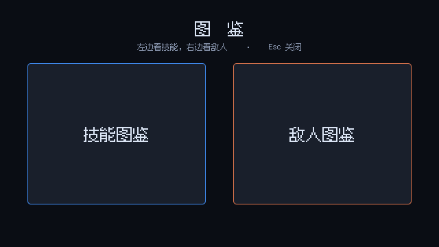
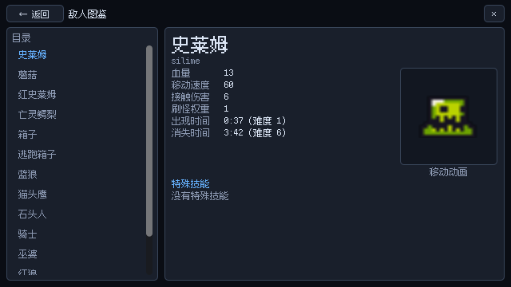
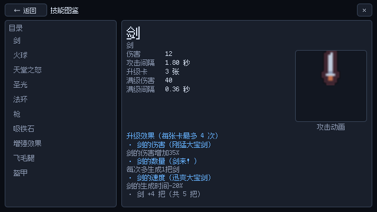

# 13 · 图鉴（技能 / 敌人）

主世界里的「图鉴终端」靠近按 **空格** 打开：先选左边「技能图鉴」或右边「敌人图鉴」，进去后左边是目录、右边是详情。打开时 `get_tree().paused = true`，关掉恢复。

## 界面结构（节点版）

界面**全部用 Control 节点在场景里搭**（`scene/ui/图鉴/图鉴.tscn`，37 个节点），脚本 `script/ui/图鉴/codex.gd` 只负责填数据、切页签、暂停/恢复，不再用代码拼界面。

```text
Codex (CanvasLayer, layer=100, process_mode=ALWAYS)   挂 codex.gd
└── Root (Control 全屏)
    ├── Dim (ColorRect 全屏底色)
    ├── Home (Control)
    │   ├── Title / Hint (Label)
    │   ├── Skill (Button 260×206)   技能图鉴
    │   └── Enemy (Button 260×206)   敌人图鉴
    └── Page (Control，默认隐藏)
        ├── Header (HBoxContainer)
        │   ├── Back (Button ← 返回)
        │   ├── Title (Label，SIZE_EXPAND_FILL)
        │   └── Close (Button ×)
        └── Body (HBoxContainer)
            ├── Sidebar (PanelContainer 190 宽)
            │   └── Margin (MarginContainer 6) → VBox
            │       ├── “目录” (Label)
            │       └── Scroll (ScrollContainer) → List (VBoxContainer，挂 Theme)
            └── Detail (PanelContainer)
                └── Margin (MarginContainer 8) → VBox
                    ├── Name / Sub (Label)
                    ├── Top (HBoxContainer)
                    │   ├── Stats (GridContainer 2 列，脚本填行)
                    │   └── Media (VBoxContainer 122 宽)
                    │       ├── MediaPanel (PanelContainer 122×122)
                    │       │   ├── ViewportContainer (SubViewportContainer stretch)
                    │       │   │   └── StageViewport (SubViewport 透明、UPDATE_ALWAYS)
                    │       │   │       └── Stage (Node2D，动画摆这里)
                    │       │   └── Video (VideoStreamPlayer，默认隐藏)
                    │       └── Caption (Label 小字)
                    ├── Section (Label，如“特殊技能”)
                    └── Extra (ScrollContainer) → ExtraBox (VBoxContainer，脚本填)
```

用到的 Control 子类：`Control`、`ColorRect`、`PanelContainer`、`MarginContainer`、`HBoxContainer`、`VBoxContainer`、`GridContainer`、`ScrollContainer`、`SubViewportContainer`、`SubViewport`、`Label`、`Button`、`VideoStreamPlayer`（`TextureRect` 留给以后放立绘/图标）。

- 目录按钮的样式写在场景里的 **Theme**（挂在 `List` 上），脚本只负责 `text` 和选中颜色；
- 切换敌人/技能页签时会把目录**滚回顶部**（`list_scroll.scroll_vertical = 0`），不然从敌人页滚到底再切技能，会看不到开头的剑 / 火球；
- 属性行、技能/升级列表是数据驱动的，所以由脚本往 `Stats` / `ExtraBox` 里塞 Label；
- 动画预览放在 `SubViewport` 里（`stretch = false`、`UPDATE_ALWAYS`），这样不会被 UI 面板裁切；
- 像素图预览只用**最近邻过滤 + 整数倍放大**（`stage.texture_filter = NEAREST`、`floor(96 / 边长)`），否则边缘会糊。

- 首页：
- 敌人页：
- 技能页：

## 数据从哪来

| 内容 | 来源 |
| --- | --- |
| 敌人列表 / 血量 / 速度 / 出现难度 | `resource/enemy/*.tres`（`EnemyUnlockEntry`）+ 实例化场景读组件（不进树，不跑 `_ready`） |
| 特殊技能 | 敌人场景里的组件，按组件脚本映射成名字（`SKILL_INFO`），可单个敌人覆盖（`SKILL_OVERRIDE`，例如激光石头人 →「激光攻击」）。**实体碰撞 / 受击表现这类通用组件不算技能**，不在表里 |
| 出现时间 | 难度 × **37 秒**（`DIFFICULTY_SECONDS`），格式化成 `分:秒`，同时标难度数字 |
| 技能伤害 / 间隔 | `ABILITY_TABLE` 里六个控制器场景：实例化后调一次 `set_variable()` 读基础值（不进树，不跑 `_ready`） |
| 升级效果 | `resource/upgrades/\*\*/*.tres` 里同类 `Sort` 的卡 |
| 满级数值 | `MAX_STATS` 表：伤害 = 基础 × 倍率⁴，间隔 = 基础 × 0.2（每张卡选 4 次） |
| 动画 | 只摘场景里的 `AnimatedSprite2D` / `Sprite2D` / `AnimationPlayer`，其它带逻辑的节点全部丢掉 |
| 敌人排序 | 按 `unlock_difficulty` 的**绝对值**从小到大（1 → 21），同值按名字 |

> `AnimationPlayer` 的动画轨道里有 `queue_free`、`flip`、`the_first_damage` 这些方法调用，直接播会把预览节点删掉或报错。
> 现在的做法是：跳过 `RESET`（只有 0.001 秒）→ 取最长的那个动画 → 复制一份、**删掉所有方法轨道** → 关掉场景自带的 `autoplay` → 再循环播放，所以剑 / 圣光 / 天堂之怒也能看到攻击动画。

## 怎么改

- **敌人中文名**：`script/ui/图鉴/codex_data.gd` 的 `ENEMY_NAMES`；
- **技能名 / 说明**：`SKILL_INFO`，个别敌人特例写进 `SKILL_OVERRIDE`；
- **玩家能力名 / 分类 / 控制器场景**：`ABILITY_TABLE`（加新能力就在这里加一行）；
- **给某个能力配演示视频**：`ABILITY_VIDEO` 里填 `res://...ogv`，键是控制器节点名（如 `sword_ability_controller`）或角色能力卡的文件名（如 `iron_stone`）。填了之后图鉴会用视频替换掉动画预览；
- **角色能力**（吸铁石 / 增强效果 / 飞毛腿 / 盔甲）没有攻击动画，默认显示「演示视频待补充」，录好视频填进 `ABILITY_VIDEO` 即可。

## 满级属性怎么算

技能页在普通属性下面多一块「满级（每张卡选 4 次）」：

- **伤害** = 基础伤害 × 伤害倍率⁴（剑 ×1.35⁴、火球 ×1.2⁴、圣光 ×1.3⁴、法环/天堂 ×1.25⁴/×1.35⁴）；
- **攻击间隔** = 基础间隔 × 0.2（`wait_range` 从 1 每次 -0.2，4 次后到 0.2）；
- 额外效果直接写在表里（剑 +4 把、火球穿透 +12、光柱 +8 道……）；
- 枪是一整套弹夹系统，显示「以默认步枪计」的换算文字。

要改倍率就改 `script/ui/codex_data.gd` 的 `MAX_STATS`。

## 入口

`scene/场景互动件/图鉴终端.tscn`（`script/场景互动件/codex_terminal.gd`）：`Area2D` 靠近显示「按空格打开图鉴」，按空格实例化 `scene/ui/图鉴/图鉴.tscn`。把它拖进 `main_map`，摆在「怪物及技能图鉴」标签旁边即可。