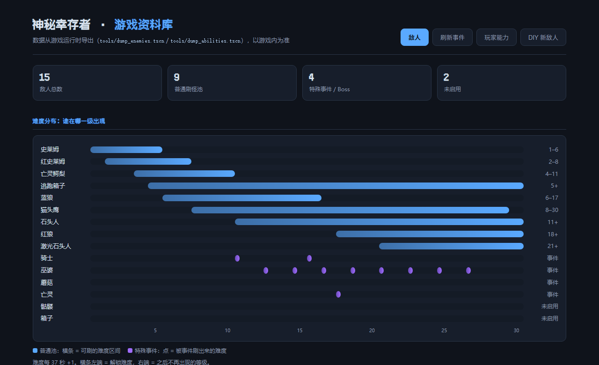

# 神秘幸存者 · 文档目录

这里是《神秘幸存者》的开发文档。**第一次来请按顺序读 01 → 02 → 03**，
只想改某个功能就直接跳到对应章节。

---

## 全部文档

| 编号 | 文档 | 一句话说明 | 适合谁 |
| :---: | --- | --- | --- |
| 01 | [快速开始](01-快速开始.md) | 装什么、怎么跑、怎么调试和导出 | 所有人 |
| 02 | [项目结构](02-项目结构.md) | 每个目录 / 场景 / 脚本分别是干什么的 | 想找代码的人 |
| 03 | [架构总览](03-架构总览.md) | 自动加载、信号总线、组件化敌人、能力系统、管理器 | 想改系统的人 |
| 04 | [代码风格](04-代码风格.md) | 项目里的书写习惯，提 PR 前请先看一眼 | 贡献者 |
| 05 | [大厅与传送门](05-大厅与传送门.md) | 取消主界面的设计、传送门动画与"进入游戏"的完整实现 | 做大厅功能的人 |
| 06 | [场景与UI流程](06-场景与UI流程.md) | 从大厅到战斗、死亡/胜利、返回大厅的完整流程 | 想理清流程的人 |
| 07 | [素材与资源](07-素材与资源.md) | 素材来源、主题字体、音频总线、导入设置 | 换美术 / 加音效的人 |
| 08 | [开发路线](08-开发路线与待办.md) | 做完了什么、在做什么、接下来做什么 | 想看进度的人 |
| 09 | [技术要点](09-技术要点.md) | 项目真正的技术亮点、量化数据、简历话术与"不能写"清单 | 写简历 / 面试 / 对外介绍的人 |
| 10 | [性能优化记录](10-性能优化记录.md) | 微基准怎么测、优化了什么、没做什么、为什么 | 想了解性能细节的人 |
| 11 | [简历技术要点](11-简历技术要点.md) | 可以直接抄进简历的版本（含面试问答） | 求职 / 对外介绍 |
| 12 | [模板与工具函数](12-模板与工具函数.md) | 加新内容前必看：敌人 / 能力 / 刷怪 / 互动件 / UI 的模板与现成函数 | 要往游戏里加东西的人 |
| 13 | [图鉴](13-图鉴.md) | 游戏内技能 / 敌人图鉴：入口、布局、数据来源、怎么加演示视频 | 维护图鉴内容的人 |

---

## 按目的找文档

| 我想…… | 看这里 |
| --- | --- |
| 把项目跑起来 | [01-快速开始](01-快速开始.md) |
| 找到某个功能的代码 | [02-项目结构](02-项目结构.md) |
| 搞懂 `GameEvent` 是干嘛的 | [03-架构总览](03-架构总览.md) 的「信号总线」一节 |
| 加一种新敌人 / 新能力 / 新刷怪事件 | 先看 [12-模板与工具函数](12-模板与工具函数.md) |
| 改图鉴里的名字 / 技能说明 / 加演示视频 | [13-图鉴](13-图鉴.md) |
| 改传送门的样子 / 时长 | [05-大厅与传送门](05-大厅与传送门.md) |
| 在大厅里加一个新的可互动物品 | [05-大厅与传送门](05-大厅与传送门.md) 的「继续加其它入口」一节 |
| 弄清楚死亡后为什么回到大厅 | [06-场景与UI流程](06-场景与UI流程.md) |
| 换字体 / 换主题 / 换音乐 | [07-素材与资源](07-素材与资源.md) |
| 知道下一步该做什么 | [08-开发路线](08-开发路线与待办.md) |
| 写简历 / 做项目介绍 / 准备面试 | [09-技术要点](09-技术要点.md) → [11-简历技术要点](11-简历技术要点.md) |
| 看性能优化怎么做的、有没有数据 | [10-性能优化记录](10-性能优化记录.md) |

---

## 网页 / 工具

| 东西 | 说明 |
| --- | --- |
| [游戏资料库（网页）](enemies.html) | 双击就能打开，五个页签：**敌人**（血量 / 速度 / 权重 / 立绘 / 技能 + 难度分布图）、**刷新事件**、**玩家能力**（27 张升级卡）、**难度设定**（四种模式的数值与 tag）、**DIY 新敌人**（可上传立绘 + 写机制） |
| [tools/dump_enemies.tscn](../tools/dump_enemies.tscn) | 改了敌人数据后，Godot 里按 `F6` 跑一次，重新生成 `enemies-data.json` 和立绘 |
| [tools/dump_abilities.tscn](../tools/dump_abilities.tscn) | 改了升级卡后，`F6` 跑一次，重新生成 `abilities-data.json` |

> 图鉴网页的数据来自**游戏运行时**（实例化每个敌人场景后读数），不是手抄的配置表。
> 数值有冲突时，以游戏内为准。

---

## 文档写作约定

- 文档用**中文**写，代码里的标识符保持英文；
- 文件名用 `编号-中文标题.md`，编号决定阅读顺序；
- 文档里出现的路径一律写成 `res://...` 或仓库相对路径，方便在编辑器里搜索；
- 新增功能时，顺手更新本目录里对应的那张表（尤其是 [08-开发路线](08-开发路线与待办.md)）。